# Pattern Recognition 2026 Project: Lesion Detection and Classification using YOLOv8
---
Name: Zakery Tsin  
Student ID: s48741510

## Key Project Information
Dataset: ISIC2017 \
Model: YOLOv8 (pre-trained models available via ultralytics) \
Description: Developing a model using YOLOv8 which detects and classifies lesions within the ISIC 2017 dataset. Analyse how this model balances precision and recall, and in turn optimise it to achieve the ideal balance between these factors. Subsequently, develop an operational policy which triages biopsy based on suspected maligncancy of lesion (classification).

## YOLOv8
### Algorithm Description
YOLO (You Only Look Once) models are a family of object detection models. They combine bounding box prediction and class labelling within a single pass (rather than traditional two-stage approach employed by other model types). In other words, YOLO models identify regions of interest (bounding boxes) for where an object is present, and then classify that specific region of interest (class labelling) within a single pass (https://roboflow.com/blog/guide-to-yolo-models). General YOLO models significantly improved runtimes and thus efficiency by drifting from the traditional CNN multi-stage detection methods to the aforementioned single-pass methodology. While earlier models did initially struggle with maintaininng accuracy of their predictions, the various iterations the family has gone through (all the way up to YOLOv26 as of Oct 2026) has acted to rectify this issue, with models such as YOLOv8 able to maintain accuracy while also greatly improving runtimes (https://arxiv.org/pdf/2208.00773).

### Structure
In general, "every Ultralytics YOLO model is built from three stages: a backbone that extracts features, a neck that fuses them across scales, and a head that predicts boxes and classes" (https://docs.ultralytics.com/guides/yolo-architecture). The fundamental unit for these models is the Conv block (2D convolution, bacth normalization, SiLU activation). YOLOv8 is simply a version of YOLO. Its core structure can be found here https://docs.ultralytics.com/guides/yolo-architecture, and a diagram is included within the repository (developed by GitHub user RangeKing). 

Evolving from YOLOv5, major architectural differences between YOLOv8 and its predecessors include an achor-free detection head, which "simplifies the training process by removing the need to manually configure anchor boxes [per dataset]", a C2f module, which "improves gradient flow and allowed the model to learn richer feature representations without a significant increase in computational cost" and a decoupled head structure, which seperates classification and regression and has been shown to improve convergence speed and accuracy (https://docs.ultralytics.com/compare/yolov8-vs-yolov5). 

# Feasability Report
The feasability report completed for this project is attached via this [link](<lesion-detection-48741510/Supporting/Feasability Report.pdf>).

*Please note that major changes have occurred since this feasability report, in particular the use of ISIC2018 to ISIC2017. I did message EdBoard regarding this, however I was unable to get sufficient information to get ISIC2018 up and running. As such, made the change to ISIC2017 due to its inclusion in Rangpur already.*

# Dependencies
Dependencies required for this project are included within [requirements.txt](lesion-detection-48741510/Supporting/requirement.txt) . Note that *ultralytics* is built on top of PyTorch, and thus installing this package will install the necessary modules for this functionality.

# Examples
Example outputs stem from the two files [predict.py](lesion-detection-48741510/predict.py) and [evaluate.py](lesion-detection-48741510/evaluate.py). Examples of these outputs are shown below.

**predict.py (run on ISIC_0015963.jpg)**
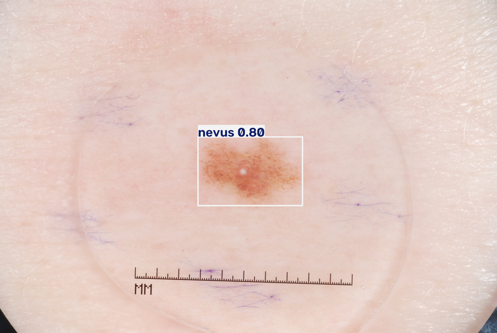

**evaluate.py (validation batch 01)**
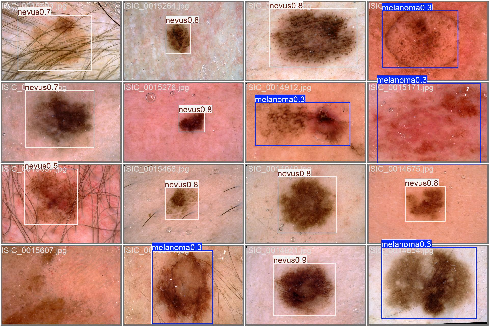

# Data Pre-Procesing
## Pre-Processing Images for YOLO compatibility
In line with project requirements, a pretrained YOLOv8.n model was utilised via the ultralytics package. Dataset.py acts to process ISIC2017 images into a version compatible with YOLO models (in line with ultralytics documentation). Running this file produces three core outcomes which are necessary for YOLO models to run:
1. Sets up parallel directories for train (/imgs, /labels) and val (/imgs, /labels) splits
2. Converts masks to bounding boxes and subsequently converts images into associated annotation.txt files
3. Automatically writes a configured data.yaml file**
**This was initially done manually, however changing this manually became cumbersome thus this was automated (via config.py file)

## Data Splits
Training, validation and testing splits were already provided as part of the ISIC2017 data. A link to this data and the steps required for its organisation will be linked in the reproducibility section

# Reproducibility
In order to reproduce the results obtained within this repository, follow the below framework. Note that ultralytics is natively built on top of PyTorch, and framework is based on the assumption Rangpur (UQ HPC) is being utilized.

1. Install dependencies using [pip install -r requirements.txt]
2. Download ISIC2017 dataset from https://challenge.isic-archive.com/data/#2017. Unzip folder into data/ISIC2017/
3. Run dataset.py to create YOLO compatible directories, annotation files (bounding boxes) and data.yaml files. Verify console output is [train:2000, val: 150, test: 600] pairs (ISIC2017 splits). Images stored in data/yolo/
4. Upload images (data/yolo), config.py, modules.py and train.py to Rangpur directory (within same directory). Run [python train.py] on GPU via Slurm job request (ensuring Rangpur directory has correct dependencies installed as well). 
        *Outputs go to runs/detect/runs/[run name]. These include weights/best.pt (best model), args.yaml (settings utilised), results.csv, results.png and validation plots.*
5. Copy weights/best.pt into project directory (local machine). 
6. Run evaluate.py to generate model performance metrics (mAP, mean IoU, Precision (P), Recall (R), etc.). 
7. Run predict.py for per-detection results and annotated images. Outputs will be saved under outputs/predict

# Investigation of the Open Research Dilemma
## Quantitative Benchmarking
### Training Results
Results of model training are visualised below within 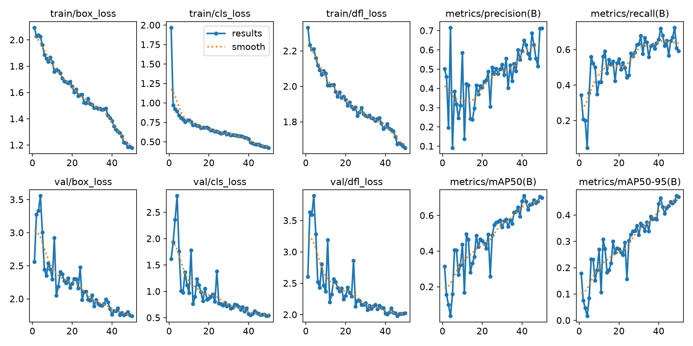. 
This illustrates loss minimisation as epoch count rose, with an associated increase in performance metrics despite a non-linear increase. The F1-Confidence curve illustrates the confidence level to achieve the optimal balance between precision and recall given the current model. The generated PR curve illustrates the tradeoff between avoiding false positives (precision) and catching all actual positive (recall). In terms of the Open Research Dilemna, recall should likely be prioritised due to the inherent danger associated with missing a positive malginancy (a melanoma). For example, prioritising a recall of 0.8 using this model would result in an approximate 0.6 precision based on the PR curve, which may lead to increased clinic visits at the benefit of ensuring clinically significant malignancies are biopsied and caught.

### Test Performance
The baseline model utilised to test performance on ISIC2017 dataset was YOLOV8, in particular "yolov8n.pt". This possessed weights pre-trained on the COCO dataset. Default ultralytics model.train parameters were utilised, with the model trained on 50 epochs and with an initial image size of 640. 

The final models configuration that I used for this report can be found in [config.py](lesion-detection-48741510/config.py). Key parameter changes which resulted in the greatest increase in mean IoU was image size from 640 to 1024. Full results for this models performance can be found in [results.md](lesion-detection-48741510/Supporting/results.md), all of which are based on the ISIC2017 test split (600 images). IoU is the top-confidence predicted box against the mask-derived box. A comparison of the baseline and final model are shown below:

| --- | Baseline | Final |
| --- | --- | --- |
|Mean IoU, all images | 0.703 | 0.753 |
|Mean IoU, best detection/image | 0.775 | 0.805 |
| Melanoma, mean IoU | 0.655 | 0.714 |
| SK, mean IoU | 0.615 | 0.694 |
| Nevus, mean IoU | 0.737 | 0.777 |
| mAP50 | 0.546 | 0.564 |
|mAP50-95 | 0.288 | 0.331 | 
| Images with IoU > 0.8 | 41.2% | 52.5% |
| P | 0.477 | 0.551 |
| R | 0.614 | 0.547 |
| Overall Accuracy | 0.747 | 0.713 |
| melanoma vs rest | sensitivity = 0.470, specificity = 0.921, AUC = 0.764 | sensitivity = 0.350, specificity = 0.919, AUC = 0.735 |

The F1, PR Curve and Confusion Matrix is also shown below for the test split.
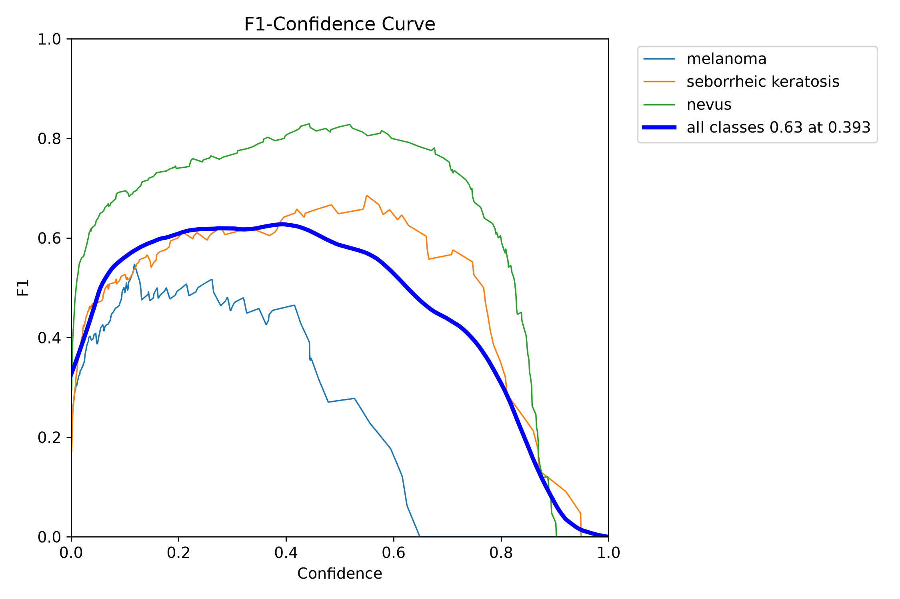

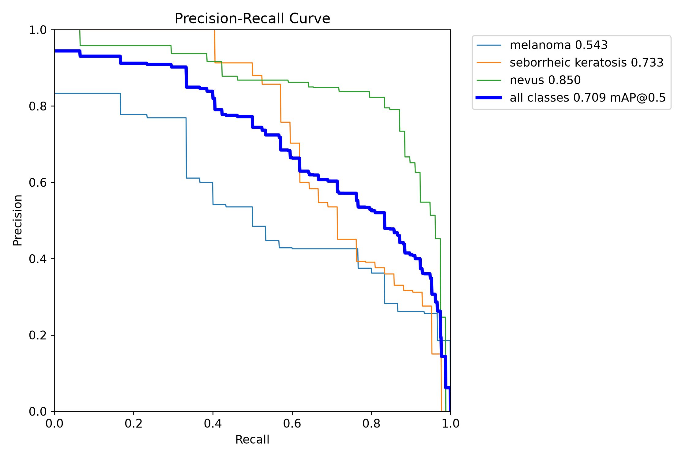

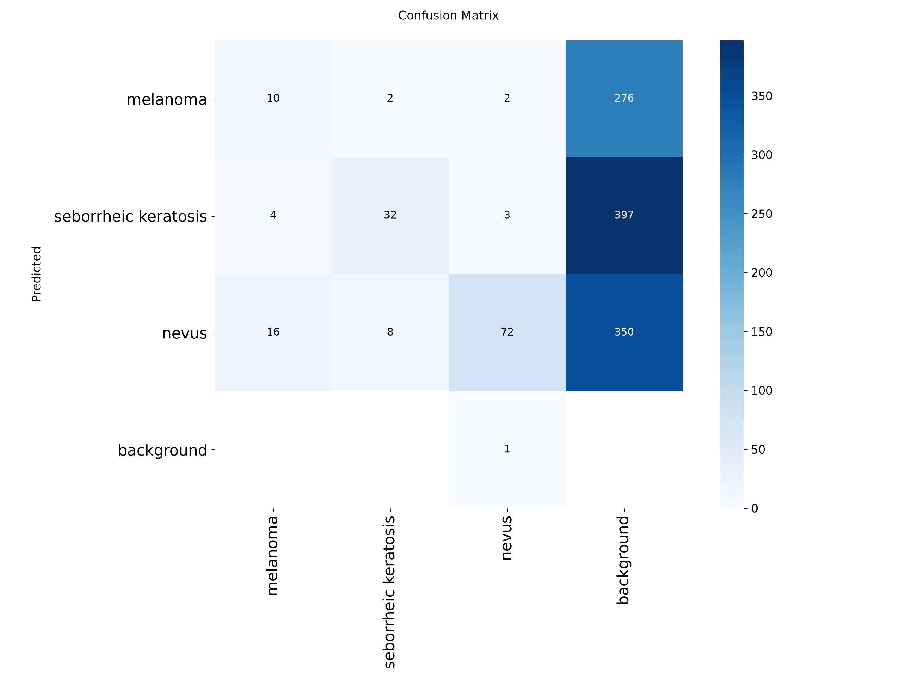

The final model improves localisation at the expense of classification. Against the baseline, mean IoU rose from 0.703 to 0.753 (+0.050), and every class improved (melanoma 0.655 to 0.714, SK 0.615 to 0.694, nevus 0.737 to 0.777). The share of test images reaching IoU ≥ 0.8 rose from 41.2% to 52.5%. In contrast, overall accuracy fell from 0.747 to 0.713, melanoma sensitivity from 0.470 to 0.350, and melanoma AUC from 0.764 to 0.735. Precision rose (0.477 to 0.551) while recall fell (0.614 to 0.547), meaning the final model produces fewer spurious detections but finds fewer true lesions at the evaluated threshold. mAP50 changed little (0.546 to 0.564), as it only requires an overlap of 0.5. The increase in mAP 50-95 from baseline to final model supports improved IoU.

These changes are consistent with the tuning of hyperparameters in the final shown model, with this version emphasising box regression via box, dfl and cls. Note that other models I tested did include more parameters, however this model possessed the best performance with the simplest set of parameters thus I utilised this. The individual contribution of each change could not be sufficiently isolated, and was instead implemented as a whole block.

The clinical implication is important. A melanoma sensitivity of 0.350 means roughly 65% of test melanomas would be missed under the default top-confidence rule, so the final model is not suitable for unsupervised use. The use of this model as a detection AND classification method is not recommended; a two stage model may be more suitable for this, whereby if a lesion is detected then a seperate classification model is run on them instead.

As outlined within results.md, the target mean IoU of > 0.8 was unable to be met. This was despite extensive experimentation on the YOLOv8 configuration, which are as outlined below.

| # | Modification | Type | Change tested | Test mean IoU | IoU ≥ 0.8 | Outcome |
|---|---|---|---|---|---|---|
| 0 | Baseline YOLOv8 | Training | Default config, 640 px, 50 epochs | 0.750 | 51.7% | Reference |
| 1 | Larger image size | Training | 640 → 1024 px | 0.755 | 52.5% | Marginal IoU gain (+0.005). Clear classification gain (accuracy 0.718 → 0.757, melanoma sensitivity 0.368 → 0.547) |
| 2 | Longer training | Training | Increased epochs | No gain | n/a | No improvement |
| 3 | Box merging | Post-processing | Confidence-weighted average of boxes overlapping the top box | 0.758 | 53.3% | No meaningful change (within run-to-run variation) |
| 4 | Oracle best-box diagnostic | Diagnostic | Best candidate box per image, chosen using ground truth | 0.803 | 58.3% | Upper bound only, not an achievable result. Shows ≤ 0.05 headroom from box selection |
| 5 | Box shape diagnosis | Diagnostic | Bias report (predicted minus true) | n/a | n/a | Boxes well centred, but median predicted/true area ratio 0.84. Width and height errors are large and bidirectional |
| 6 | Filtered mask labels | Dataset | Ignore mask fragments < 15% of the largest region | Unchanged | Unchanged | 58 of 2750 images had multiple regions, 177 fragments ignored. No measurable effect |
| 7 | Box scale calibration | Post-processing | Width and height ×1.02, fitted on val | 0.771 | 57.8% | +0.016 gain, but still below 0.8. Not retained in the final code |
| 8 | Consensus box selection | Post-processing | Confidence-weighted consensus box, `min_conf` = 0.1 (chosen on val) | 0.755 | 52.5% | Val improved (0.784 → 0.797) but test did not (0.755 → 0.755). Likely val noise |
| 9 | Larger model | Training | About 3.5× parameters (11.1M vs 3.1M), 1024 px, default augmentation | 0.755 | 53.0% | IoU unchanged. Classification worsened (accuracy 0.693, melanoma sensitivity 0.444, mAP50 0.505). Possible overfitting of the model. |
| 10 | Augmentation training | Training | mosaic = 0, scale = 0.15, translate = 0.05, flipud = 0.5 | 0.743 | 50.3% | No real significant difference between final model. |

Further attempts to improve IoU resulted in increasingly worse performance on classification. Due to the negative effects of this poor classification, which could result in a malignancy being diagnosed as a non-malignancy, no further changes were made to the model, with other hyperparameters left as their defaults due to the higher performance of this final model. 

## Computational Resource Table
| Resource | Value |
| --- | ---|
| Peak GPU RAM | 5.11G |
| Paramater Count | 3,133,193 | 
| Inference Runtime/Latency | Speed: 1.7ms preprocess, 68.4ms inference, 0.0ms loss, 0.3ms postprocess per image |

## Failure Analysis
Failure cases were drawn from the ISIC 2017 **test split** (600 images) using the final model with single-pass, top-confidence box selection. In each overlay, the green box is the ground-truth box and the **red box** is the model's prediction. Each overlay is labelled with the true class, predicted class, confidence and IoU.

Cases were chosen to cover the main error modes visible in the quantitative results. They are grouped into classification failures and localisation failures. Explanations of cause are **hypotheses based on visual inspection**. Note that the nevus class is defined by exclusion (neither melanoma nor seborrheic keratosis), so it represents either nevus or some other benign case (not classified). Test cases were sourced from outputs/examples, which is generated via evaluate.py when program is run.
### Part A: Classification Failures
#### Failure Case 1: Non-Malignancy Identified as Malignancy (SK --> Melanoma)
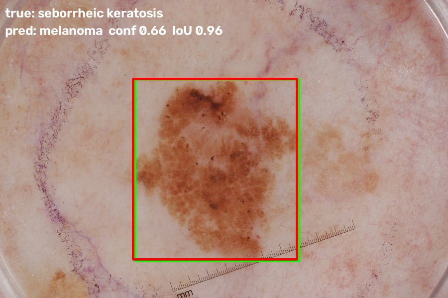
**Observation:** The lesion shows irregular borders and pigmentation noticeably darker than that of typical SK examples in the dataset.
**Hypothesis:** These features overlap with those associated with early-stage melanoma, which may explain the prediction.
**Implication:** Under the proposed operating policy this is a false alarm that would be routed to clinical review, increasing clinic burden but posing no patient risk.

#### Failure Case 2: SK predicted as nevus / other benign
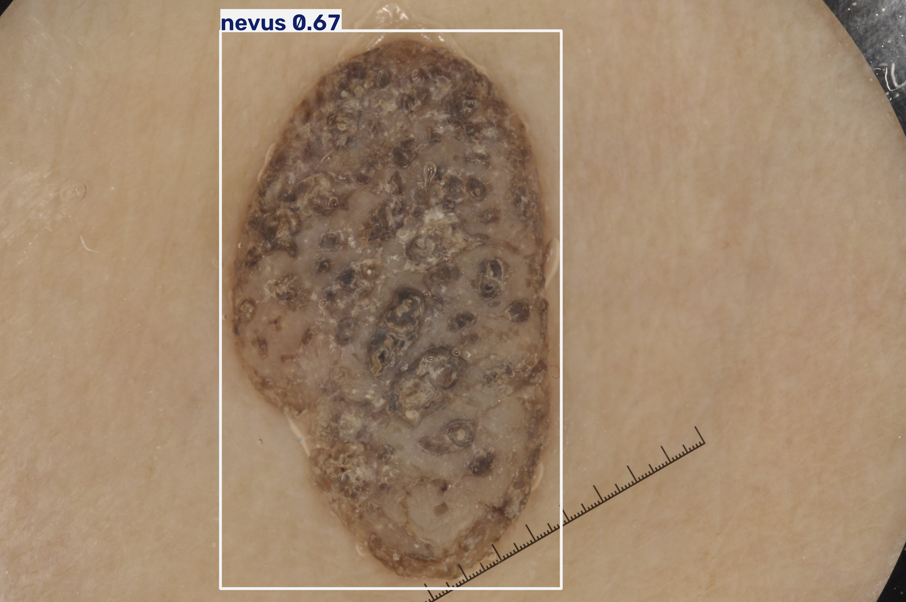
**Observation:** The lesion appears to display features typical of well-developed/severe SK. In the example images inspected, similar severities of SK presentations were uncommon, with most ground-truth SK images appearing milder.
**Hypothesis:** If this holds across the dataset, the model may have seen few advanced SK presentations in training. This could explain its poor classification performance.
**Implication:** Both classes are benign, so the clinical risk is low. The error would still misdirect follow-up.

#### Case 3: Missed melanoma, predicted as nevus / other benign
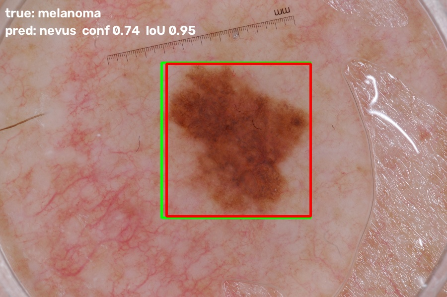
**Observation:** The lesion has relatively smooth, well-defined borders, a feature more typical of nevus than of melanoma.
**Hypothesis:** Border regularity is only one of several dermoscopic cues, but the model may rely heavily on it. Class imbalance in ISIC2017 means that the model may also have limited exposure to atypical-looking melanomas.
**Implication:** This is the clinically most serious error type, since an automatically cleared melanoma delays diagnosis. It motivates a lowered melanoma decision threshold in the operating policy (see the Recommendations section).

### Part B: Localisation failures
#### Failure Case 4: Low IoU with with poor bounding box 
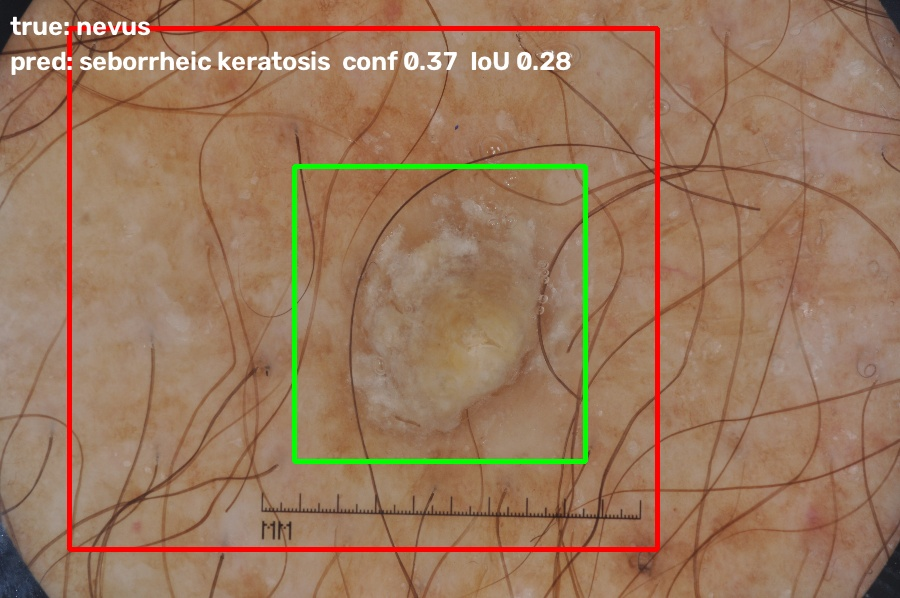

**Observation:** Poor IoU, with models bounding box dramatically larger than ground truth. The surrounding skin appears flaky with lots of hair present, which may produce a texture that resembles a potential lesion boundary.
**Hypothesis:** Surface texture may have shifted the predicted extent, and the model may also have confused the lesion type (SK predicted in place of nevus).

#### Failure Case 5 Multi-part or fragmented lesion
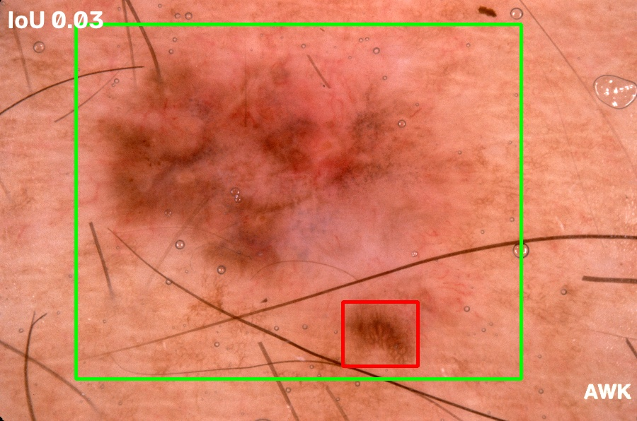
*NOTE*: This is from worst-ious study into possible ways to improve mean IoU
**Observation:** Poor IoU, with model focussed on a single fragment of a much larger lesion. For additional context, as part of testing to try and improve Mean IoU across all classes, a set of 20 of the worst-case IoU images was produced. Of these 20, 6 contained multi-part lesions.
**Hypothesis:** Multi-part lesions harder to classify, and the model instead focussed on the fragment that was more pronounced (pigmented) and with more regular borders, which it has likely seen much more similar variations of when in training.

## Actionable Engineering Recommendation
The initial baseline YOLOv8 model possesses overall worse IoU but crucially better melanoma sensitivity. While the final model utilised did localise better, due to the marked reduced effectiveness of melanoma sensitivity and the significant impacts missed melanomas can have, the initial baseline model should likely be utilised in order to minimise this effect. Furthermore, this model should be used as a diagnostic tool only, with results pipelined to physicians for review rather than relying on it automatically.

For future work, further research into the augmentation of the existing ISIC2017 dataset should be conducted in order to observe whether this would improve the performance of the models on melanoma and SK variants. While I tried my best and spent significant time tuning and making attempts to improve these performance metrics, I was unable to find a blend which accomplished high IoU while maintaining classification specificity. As such, the use of the baseline model, with potentially a higher IMGSZ than the default 640/1024 that I used, may yield better results.

# Limitations of the Study
ISIC2017 does not ship with patient ID labels, and as such leakage was unable to be assessed despite best attempts made to try. Unless done externally, each image is treated as independent, even if it is the same picture of a lesion. The ISIC2017 dataset also has a major class imbalance, with images weighted mainly to Nevus, with much less images attributed to SK or Melanoma types. This is a further exacerbated by the major variation between SK and Melanoma cases, and resulted in the model performing worse on these test cases, as the reduced training images available meant the model struggled to generalize. Augmentation of the dataset itself rather than further modifications of the YOLOv8 model may yield better results. 

# Artifical INtelliegence Usage Disclosure
The AI tool used for this project was Claude Sonnet 5.0 (Medium). It was used as a supplementary research tool, however mainly it was used as a coding assistant for the various files of this project. When used, a NOTE is included within the codebase. In summary, the tool was used to:
- Provide initial pseudocode structure for dataset.py and evaluate.py
- Identification of constants to be moved out into config.py file for code readability
- Writing experimental code (eg. consensus, TTA) for testing of model optimisation (Note that this code was later removed)
- General debugging of code
- Writing of Parser (deleted) and Print sections (in order for readability of data)
- Writing of certain functions, especially in evaluate.py - noted throughout codebase
- Suggestions for tuning of ultralytics hyperparameters 
- Interpretation of content and produced results (in parallel with external research)

In order to verify the AI code production, various steps were performed:
- Functions and files were tested in isolation and modularly, with general functionality compared to my personal understanding of what changes would/should do
- Reproducing known results, whereby after each edit the same weights were ran and outputs were checked to ensure matching.
- Consistency checking eg. per-class IoU weighted by class counts matched the overall mean IoU, class counts.image counts matched official ISIC2017 data splits
- Changes suggested by the AI (eg. consensus, TTA) which did not aid signifantly in performance were still kept
- AI tool could not run code or access data directly; created code segments were manually moved into codebase after review/verification and for testing.

